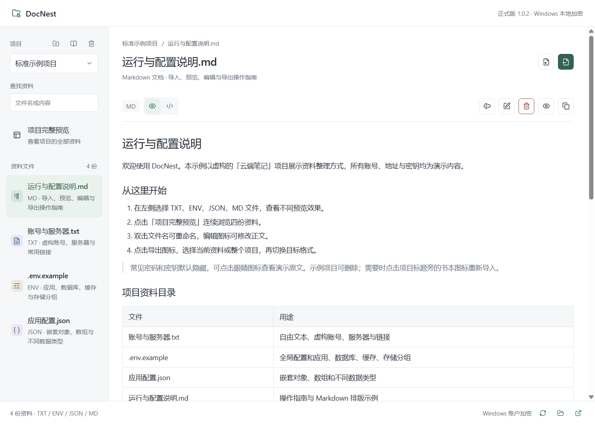
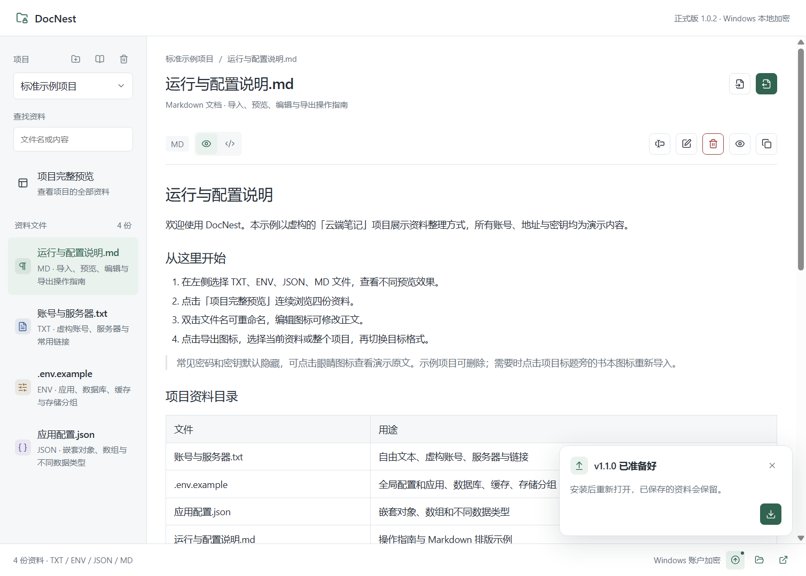

# DocNest

[](https://github.com/zeng1144318071-bot/project-vault-desktop/actions/workflows/ci.yml)
[](https://github.com/zeng1144318071-bot/project-vault-desktop/releases/latest)
[](LICENSE)

把散落在记事本里的项目说明、服务器资料和环境配置整理到一个本地桌面工具中。

DocNest 支持 **TXT、ENV、JSON、Markdown** 四种格式的导入、预览、编辑与转换，按项目集中查看，并使用 Windows 当前账户的 DPAPI 加密保存。应用每 5 分钟检查 GitHub 新版本，安装包下载完成后提示安装。

**[下载 Windows 安装包](https://github.com/zeng1144318071-bot/project-vault-desktop/releases/latest) · [标准示例](examples/README.md) · [版本记录](CHANGELOG.md) · [参与开发](CONTRIBUTING.md)**



## 能做什么

| 功能 | 使用方式 |
| --- | --- |
| 项目与文件管理 | 新建项目、搜索资料、重命名文件、删除文件或项目，支持项目完整预览 |
| TXT | 保留换行和空格，适合账号说明、操作记录等自由文本 |
| ENV | 左侧查看全部内容，右侧根据 `[app]`、`[database]` 等段名拆分配置组；可分别复制 |
| JSON | 显示格式化源码，支持嵌套对象和数组 |
| Markdown | 渲染标题、列表、表格、链接与代码块，可切换源码 |
| 导入与导出 | 选择文件或粘贴内容，自动识别类型；四种格式可切换导出 |
| 整个项目打包 | 导出项目 JSON，重新导入时恢复文件名、原始类型和正文 |
| 本地保护 | DPAPI 加密保存、保存上一版副本、安装更新前备份 |
| 更新提示 | 启动后检查，每 5 分钟再次检查；自动下载，点击确认后安装 |

统一的小图标工具栏配有悬停和键盘提示。项目切换、重命名、删除确认、更新确认使用应用内组件。复制成功提示显示 3 秒圆环倒计时，并支持系统减少动画设置。支持浅色与深色主题。

## 安装与使用

适用于 **Windows 10 / 11 x64**。从 [Releases](https://github.com/zeng1144318071-bot/project-vault-desktop/releases/latest) 下载 `DocNest-Setup-版本号-x64.exe`，安装向导提供目录输入框和“浏览”按钮，可选择自定义安装目录；从应用内更新时也显示该页面，并默认带出原安装位置。选择的是最终安装目录，例如 `D:\Apps\DocNest`。程序自带运行环境，无需安装 Node.js。安装程序创建桌面和开始菜单快捷方式；旧版可直接覆盖升级，卸载时保留用户资料。

首次启动显示一个“标准示例项目”，包含 TXT、ENV、JSON、MD 四份完整资料。示例使用虚构账号、`example.com` 域名和文档专用 IP，可自由修改或删除。已有资料升级后保留原样，可点击左侧“项目”标题旁的书本图标导入独立示例；内容完整的示例已存在时直接打开，已修改的示例保留并另建带编号的项目。按钮悬停或键盘聚焦时会显示名称。

1. 在左侧选择或新建项目，点击右上角导入图标，选择文件或直接粘贴内容。
2. 预览识别结果并保存。本地文件保留原名，粘贴内容自动命名。支持 `.env` 和 `.env.production` 等文件；必要时在文件对话框选择“所有文件”。单个导入文件上限为 10 MB。
3. 点击左侧资料查看，点击“项目完整预览”连续浏览整个项目。双击文件名或按 F2 可重命名，编辑图标可修改正文。
4. 导出时选择当前文件或整个项目，再选 TXT / ENV / JSON / MD，查看结果后保存到本机。

右下角的外部链接图标可打开本项目的 GitHub 仓库。悬停或通过 Tab 聚焦时显示完整地址，点击后由默认浏览器打开，可查看源码、版本记录或反馈问题。

标准示例也单独提供 [项目 JSON](examples/project-vault-example.json) 和 Release 中的 `DocNest-Examples-版本号.zip`。项目 JSON 可一次恢复四份原始资料；ZIP 内含四份原始文件、项目 JSON 和说明，方便测试单文件导入。详细内容见 [示例说明](examples/README.md)。

| 快捷键 | 操作 |
| --- | --- |
| Ctrl+O | 导入资料 |
| Ctrl+Shift+S | 导出资料 |
| F2 | 重命名选中的资料 |
| Ctrl++ / Ctrl+- / Ctrl+0 | 放大、缩小、恢复大小 |
| F11 | 全屏 |
| Esc | 关闭下拉列表或取消弹窗 |

## 更新方式

从 **0.2.0** 起，正式安装版启动约 1.5 秒后检查 GitHub 最新稳定版，之后每 **300000 毫秒（5 分钟）**检查一次；底部刷新图标可手动检查。开发模式和自动化测试关闭更新联网。

- 发现较新版本后，通过 `electron-updater` 自动下载 Windows 安装包，显示下载进度并校验更新文件。
- 下载完成后显示持久提示。关闭提示后，底部更新图标仍可重新打开。普通退出不会自动安装。
- 点击安装图标，在应用内确认“安装并重新打开”。安装前等待保存完成，并将当前加密文件备份为 `vault.before-update.dat`。有未完成的编辑时，先保存或退出编辑。
- 网络或下载失败不会中断资料操作，下次自动检查重试。可点击底部图标手动重试。
- 仅检查稳定版，不降级。更新来源固定为本仓库的 GitHub Releases，发布者需要上传安装包、`latest.yml` 和 `.blockmap` 文件。

0.1.x 版本没有更新检查功能，需要手动安装一次 0.2.0 或更新版本。



## 数据与隐私

资料通过 Electron `safeStorage` 调用 Windows DPAPI 加密后保存在以下目录。为兼容旧版，DocNest 继续使用原应用标识、更新缓存和资料目录；更换安装目录不会移动加密资料。

```text
%APPDATA%\ProjectVaultPreview\vault.dat
%APPDATA%\ProjectVaultPreview\vault.prev.dat
%APPDATA%\ProjectVaultPreview\vault.before-update.dat  # 安装应用内更新前生成
```

底部文件夹图标可打开数据目录。保存采用临时文件替换，并保留上一版加密副本。仓库、安装包和示例不包含个人资料；应用没有资料上传、云同步或遥测功能。更新检查和下载会连接 GitHub 及其文件分发服务，请求不包含资料正文、账号或配置值。点击 Markdown 网页链接时，由默认浏览器打开。

DPAPI 依赖创建资料的 Windows 账户，尚无独立主密码或闲置自动锁定。能使用当前已登录账户的程序或人员仍可能读取资料。直接复制加密文件到其他账户或重装后的系统通常无法解密；迁移前应在原账户导出项目 JSON，并按需要勾选“包含敏感字段”。

预览和导出默认隐藏常见密码、令牌、密钥字段，识别基于字段名称，无法保证识别任意自由文本中的所有秘密。导出的 TXT / ENV / JSON / MD 是普通明文文件，分享前请自行检查。

当前安装包未做代码签名，Windows 可能显示未知发布者或 SmartScreen 提示。Release 提供 SHA256 校验文件；更新器另外验证更新元数据中的文件校验值。这些校验不能替代发布者签名。

## 格式转换规则

- 同格式导出尽量保留原始正文，敏感字段按导出选项处理；ENV 分组只影响预览，原段名、注释、顺序与换行不被拆写。
- 项目 JSON 使用 `kind: "project-vault"` 与 `version: 1` 标识资料包，保存文件名、类型和正文，可重新导入当前项目。
- 转为 Markdown 时，其他类型正文放入对应语言的代码块。
- 转为 TXT 时，保留正文，整个项目按文件分段。
- 任意文档跨格式转为 ENV 时，使用 `NAME`、`FORMAT`、`CONTENT` 键保存资料，正文换行转义；不会猜测自由文本的生产配置含义。

## 本地开发

技术栈：Electron、原生 JavaScript / CSS、markdown-it、DOMPurify、Lucide、electron-updater、electron-builder。界面资源打包在本地，无运行时 CDN 依赖。

需要 Windows x64、Node.js 24、npm；完整窗口测试还需要 Python 3.12+。

```powershell
npm ci
npm test
npm start

# 打包可执行目录并验证四种格式、加密、编辑、更新 UI 等行为
npm run pack
python -m pip install -r requirements-test.txt
npm run test:windows

# 生成 NSIS 安装包及 GitHub 更新元数据
npm run dist
```

构建产物位于 `release/`，同时生成标准示例 ZIP 和可重新导入的 `project-vault-example.json`。`npm test` 不访问网络或启动安装程序；窗口测试仅使用独立临时目录、虚构数据和模拟剪贴板，不读取现有资料库。自动化测试入口在正式环境中不启用。

## 发布与贡献

欢迎通过 Issue 提交问题或建议，提交截图前请隐藏私密内容。开发约定与发布步骤见 [CONTRIBUTING.md](CONTRIBUTING.md)，漏洞反馈见 [SECURITY.md](SECURITY.md)。

GitHub Actions 为每个主分支提交和 Pull Request 执行 Windows 检查。维护者推送与 `package.json` 版本一致的 `v*` 标签后，发布流程会测试并生成安装包、更新描述文件、差分元数据、标准示例资料包及 SHA256 校验文件，发布到 GitHub Releases。

## 许可证

本项目使用 [MIT License](LICENSE)，允许使用、修改与再分发。第三方依赖遵循各自许可证，构建时生成 `dist-ui/THIRD_PARTY_NOTICES.txt`；Electron 与 Chromium 的声明随程序一同分发。
